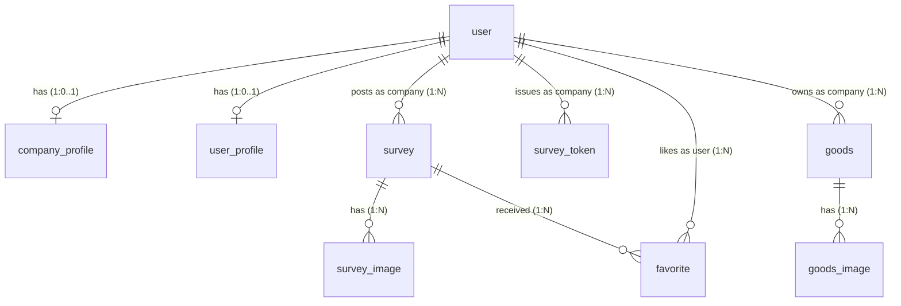

# RealPost (リアル・ポスト)

~ **やらせのない100%リアルな口コミを集める、インバウンド向け店舗アンケート＆ローカル検索プラットフォーム** ~

---

## 🌟 プロジェクト概要

「サクラレビュー（偽レビュー）」や「店舗を実際に訪れていないユーザーによる悪意ある投稿」は、飲食・観光業界における長年の課題です。

**RealPost** は、実際に店舗を訪れた顧客だけがレビューを投稿できる仕組みを提供し、信頼性100%のリアルな店舗評価を可視化するローカル検索＆アンケートプラットフォームです。

### 🤝 信頼性を担保する仕組み
1. **店舗内でのQRコード提示**: 店舗管理者が、利用回数や有効期限を制限した「アンケート回答用トークン付きQRコード」を発行します。
2. **トークンによる回答制限**: 顧客は店舗でQRコードをスキャンし、トークンが有効な場合のみアンケート回答フォームにアクセスできます。
3. **口コミとしての一般公開**: 回答されたアンケートは、店舗の「リアルな評価（RealPost）」としてタイムライン上に一般公開され、他の観光客の信頼できる店舗探しの材料となります。
4. **インセンティブの提供**: アンケートに回答した顧客に対して、店舗が事前に登録した「特典（Goods）」を提示できます。

---

## 🚀 主要機能

### 👤 一般ユーザー（観光客）向け機能
- **リアルな口コミタイムラインの閲覧**: 実際に店舗を利用したユーザーのみが投稿した、やらせのないレビュー（満足度、テキスト、写真）を閲覧。
- **多次元フィルタリング検索**: 
  - カテゴリ（グルメ、カルチャー、アクティビティ、ショッピング、その他）
  - 回答者の属性（年齢層、国籍、性別）
  - キーワード検索、満足度評価
- **お気に入り機能**: 気になった店舗の口コミや詳細をお気に入りとして保存。
- **セキュアなアンケート回答**: QRコードから遷移し、国籍、年齢、性別、満足度（5段階）、コメント、写真を入力して送信。
- **店舗特典（Goods）の確認**: アンケート回答によって獲得できる店舗独自の特典を閲覧。

### 🏢 店舗（企業）管理者向け機能
- **店舗プロフィールの管理**: 店舗名、カテゴリ、SNSアカウント、店舗イメージ画像の管理。
- **Google Maps API連携による位置設定**: 地図上での店舗のプレイス検索および位置情報（Place ID）の設定・登録。
- **ワンタイムQRコードの動的発行**: 最大使用回数（`maxUses`）を指定して、アンケート回答用トークンが含まれたQRコードを瞬時に生成。
- **提供特典（Goods）の管理**: 回答者へプレゼントするノベルティなどの特典名・商品画像の登録および編集。

### 🌐 グローバル（多言語）対応
- `next-intl` を使用し、アプリ全体で**5言語**をサポートしています。
  - 日本語 (Japanese)
  - 英語 (English)
  - 韓国語 (Korean)
  - 簡体字中国語 (Simplified Chinese)
  - 繁体字中国語 (Traditional Chinese)

---

## 🛠 技術スタック

### フロントエンド / バックエンド
- **フレームワーク**: Next.js 16 (App Router)
- **ライブラリ**: React 19, TypeScript
- **スタイリング**: Tailwind CSS v4, Framer Motion (アニメーション効果)
- **多言語対応**: next-intl
- **QRコード**: next-qrcode

### データベース & 認証
- **データベース**: PostgreSQL (Neon Database Serverless)
- **ORM**: Drizzle ORM
- **認証**: Better-auth (Next.jsと緊密に統合されたセッションベース認証)

### インフラ & 外部API
- **ストレージ**: AWS S3 (店舗画像、商品画像、アンケート画像のアップロード用)
- **外部API**: Google Maps API (プレイス検索、店舗位置情報のマッピング)

### パッケージ管理
- **ツール**: pnpm

---

## 📊 データベース設計 (ER図)

本システムは、Drizzle ORMを使用して以下のリレーションを定義しています。



### 主要テーブル概要

| テーブル名 | 用途 |
| :--- | :--- |
| `user` | アカウント基本情報（企業または一般ユーザー） |
| `company_profile` | 店舗のアカウントプロフィール（店舗名、カテゴリ、位置情報のPlace ID、画像など） |
| `user_profile` | 一般ユーザーのプロフィール（国籍情報など） |
| `survey` | アンケート回答データ（満足度、回答者の年齢・性別・国籍・レビュー本文など） |
| `survey_token` | アンケート回答アクセス用のトークン（最大利用可能回数、有効期限） |
| `survey_image` | アンケートに添付された画像データ（AWS S3のURL） |
| `goods` | 店舗が登録する回答者向けの特典（景品・サービス）データ |
| `goods_image` | 特典の画像データ |
| `favorite` | 一般ユーザーとアンケート（口コミ投稿）のお気に入り紐付け |

---

## 💻 ローカル開発環境の構築

### 1. リポジトリのクローンと依存関係のインストール
```bash
git clone <repository-url>
cd real-post
pnpm install
```

### 2. 環境変数の設定
`.env.example` を参考に、プロジェクトのルートディレクトリに `.env` ファイルを作成し、必要な接続情報を設定します。

```env
# Database (PostgreSQL / Neon)
DATABASE_URL=postgresql://...

# Better Auth Configuration
BETTER_AUTH_SECRET=your_auth_secret
BETTER_AUTH_URL=http://localhost:3000

# AWS S3 Configuration (画像アップロード用)
AWS_ACCESS_KEY_ID=your_aws_key
AWS_SECRET_ACCESS_KEY=your_aws_secret
AWS_REGION=your_aws_region
AWS_BUCKET_NAME=your_s3_bucket

# Google Maps API Key
NEXT_PUBLIC_GOOGLE_MAPS_KEY=your_google_maps_api_key
```

### 3. データベースマイグレーション
Drizzle Kitを使用して、データベースにテーブルを反映します。

```bash
pnpm drizzle-kit push
```

### 4. 初期テストデータの登録 (シード)
開発をスムーズに進めるため、初期の店舗アカウントおよびアンケートのテストデータを投入します。

```bash
pnpm seed
```
*(※ これにより、プロフィールが入力済みの5つの店舗ユーザーと、それぞれの店舗に紐づく合計25件のアンケートテストデータが作成されます。)*

### 5. 開発サーバーの起動
```bash
pnpm dev
```
開発サーバーが起動したら、 [http://localhost:3000](http://localhost:3000) にアクセスします。
ユーザー画面はスマートフォンでの閲覧に最適化されたレイアウト（横幅402px）となっています。
